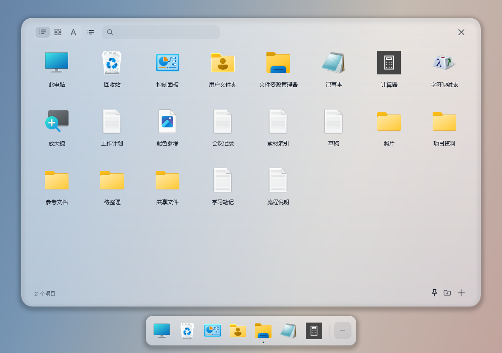
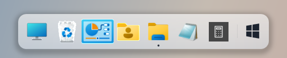
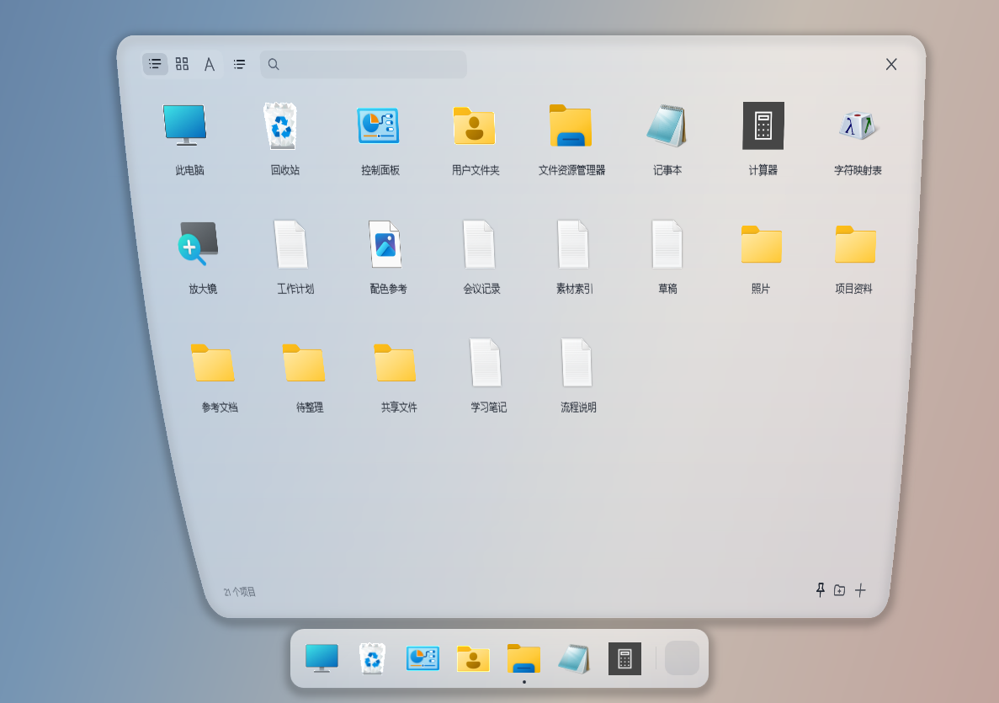

# MacDock

> [!IMPORTANT]
> 当前正式版为 **1.9.5**。历史 1.9.2 安装包曾在另一台 Windows 笔记本上触发 Microsoft Defender 的 `Trojan:Win32/Sabsik.TE.A!ml` 检测，该版本继续撤回。微软复核已提交，结果仍为 Pending。开发机对新旧安装包的 Defender 扫描均未检出，1.9.4 的 ClamAV 扫描也未检出，但不能据此保证其他设备不会告警。请保持安全防护开启；若下载被拦截，请停止运行该文件并反馈检测名称和版本，不要绕过防护。

**Windows 11 的玻璃 Dock 与桌面抽屉。** 把常用入口固定在底部，把真实桌面收进可搜索、可排序的抽屉。Windows 原生任务栏、Explorer、跳转列表和缩略图照常使用。

[下载最新版](https://github.com/bieshuowola/MacDock/releases/latest) · [使用指南](GUIDE.md) · [版本记录](CHANGELOG.md)

## 日常使用

- **Dock** · 悬停底部白条唤醒，移动指针即可波浪放大。固定、拖拽排序、切换已打开的窗口。
- **桌面抽屉** · 点击四窗格按钮，或按 `Ctrl+Alt+Space`。Genie 过渡从按钮展开。可搜索、切换列表与网格、拖动排列，并使用 Windows 原生文件菜单。
- **真实桌面** · 抽屉反映 Explorer 桌面的内容。支持深浅外观、布局调节和不同显示缩放。

查看 Genie 展开瞬间

以上截图来自 MacDock 实际运行画面，使用独立的演示配置和示例文件。

## 下载与更新

| 版本 | 适用场景 |
| --- | --- |
| Windows 安装版 | 日常使用。当前账户安装，可通过应用确认升级。 |
| Windows 便携包 | 解压后运行 `MacDock.exe`，更新时从发布页下载新版本并替换程序。 |

需要 Windows 11 x64。下载包含运行时。正式安装包尚无 Authenticode 代码签名，Windows 可能显示 SmartScreen 提示。请从本仓库的 Release 获取文件并核对 `SHA256SUMS.txt`。 [查看下载与校验文件](https://github.com/bieshuowola/MacDock/releases/latest)

应用默认每天检查更新，下载和安装由用户确认。桌面文件、应用列表和配置留在本机。遇到问题可提交 Issue，请先移除附件中的个人信息。 [隐私与兼容性说明](GUIDE.md) · [反馈问题](https://github.com/bieshuowola/MacDock/issues)

此仓库发布程序和使用资料，项目源码及开发历史保存在私有环境中。
