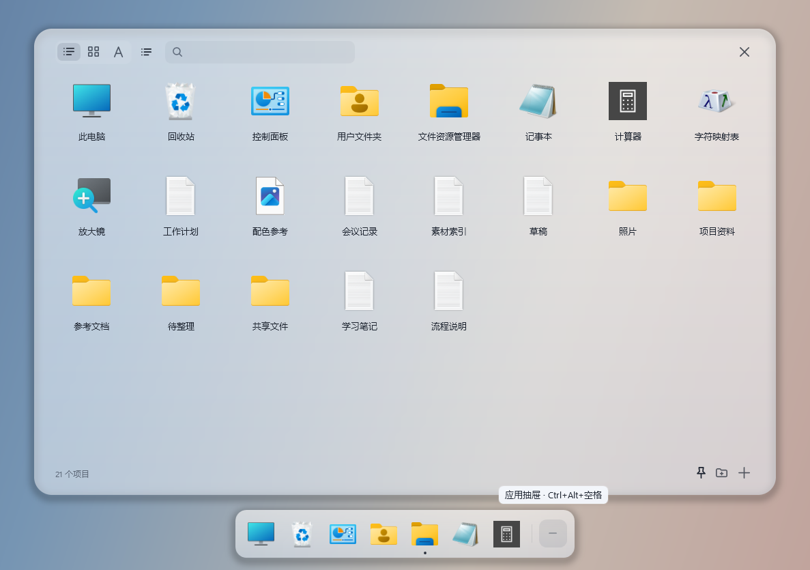
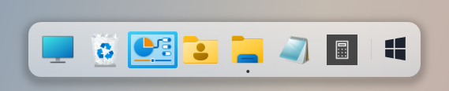
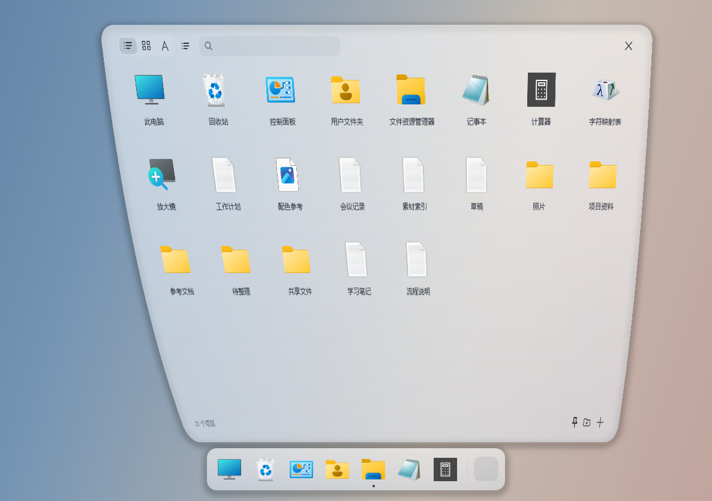

# MacDock

面向 Windows 11 的轻量级底部 Dock 与真实桌面抽屉工具

[下载最新版](https://github.com/bieshuowola/MacDock/releases/latest) · [使用指南](GUIDE.md) · [版本记录](CHANGELOG.md)

 

---

## 功能说明

### 1. 真实桌面双向镜像
抽屉直接映射 Windows 真实桌面目录，而不是单独维护一份静态快捷方式清单：
- **拖放到可执行文件（Drop-to-Exe）**：将任意文件（如游戏 MOD 源文件）直接拖放到抽屉内的 `.exe`、脚本或快捷方式图标上松开，即可将该文件路径作为命令行参数传给目标程序运行。
- **双向拖拽与外部互通**：支持拖入抽屉文件夹移动（按住 `Ctrl` 复制）、从抽屉拖出文件到微信/浏览器/编辑器/Explorer 等外部窗口，也支持从外部拖入文件直接同步到桌面。
- **原生键鼠与外壳菜单**：支持 `F2` 重命名、`Delete` / `Shift+Delete` 删除、`Ctrl+C` / `Ctrl+X` / `Ctrl+V`、`Alt+双击` / `Alt+Enter` 打开原生文件属性页，以及无转圈的 Windows 原生右键扩展菜单。

### 2. 流畅收纳过渡与交互细节
- **抽屉展开与收起**：点击 Dock 四窗格按钮或按 `Ctrl+Alt+Space`，抽屉从锚点平滑展开与收起，动画过程支持随时反向。
- **底部 Dock 栏**：支持指针悬停放大、拖拽重排、图标「单击打开 / 双击打开」切换（默认单击），以及图标快照缓存（刷新或重载期间保留最后一次有效图标）。

### 3. 智能场景避让与按键屏蔽
- **空桌面常驻与自动隐藏**：桌面无最大化或全屏窗口覆盖工作区时 Dock 保持常驻；存在最大化或全屏程序时自动平滑收起，移动指针至底部唤醒条即可唤出。
- **自定义按住屏蔽键**：支持在设置中绑定任意屏蔽键（如 `~`），按住期间立即收起 Dock 并拦截底部唤醒，松开后自动恢复。

### 4. 轻量零侵入
- 支持通过当前用户级登录计划任务实现快速开机自启（无需提权，异常时自动降级为注册表启动项）。
- 不修改系统核心文件，Windows 原生任务栏、跳转列表与缩略图预览照常工作。

---

## 界面预览

| Dock 悬停放大 | 抽屉展开过渡 |
| :---: | :---: |
|  |  |

---

## 下载与安装

| 版本 | 适用场景 |
| --- | --- |
| **Windows 安装版 (`Setup.exe`)** | 日常使用。安装到当前用户目录，支持应用内签名清单校验升级并保留现有排列与配置。 |
| **Windows 便携包 (`Portable.zip`)** | 解压后直接运行 `MacDock.exe`，更新时覆盖替换程序文件即可。 |

- 运行环境：Windows 11 x64（已自包含 .NET 8 运行时，无需额外安装）。
- 请从 [GitHub Releases](https://github.com/bieshuowola/MacDock/releases/latest) 下载并核对 `SHA256SUMS.txt`。
- 桌面文件、应用列表与配置全部保存在本地。[隐私与兼容性说明](GUIDE.md) · [问题反馈](https://github.com/bieshuowola/MacDock/issues)

安全与签名说明（含历史 1.9.2 Defender 误报记录）

- 程序和安装器尚无 Authenticode 代码签名，Windows 初次运行可能出现 SmartScreen 提示。
- 历史 1.9.2 安装包曾在另一台 Windows 笔记本上触发 Microsoft Defender 的 `Trojan:Win32/Sabsik.TE.A!ml` 检测，该版本继续撤回（微软复核已提交，结果仍为 Pending）。发布前均会做本地 Defender 定向检查，但不能保证所有设备或云端策略必然放行。请保持系统安全防护开启，并在下载后核对 `SHA256SUMS.txt`。

